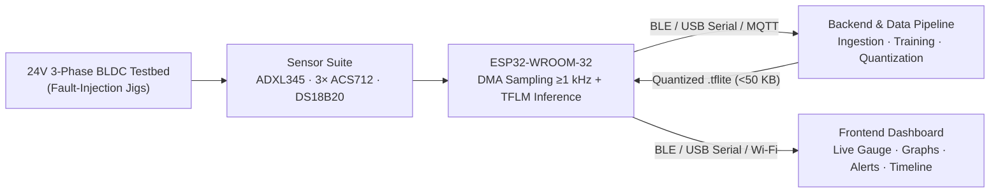

# TinyML-Based Predictive Maintenance for BLDC Motors

> **Real Failure-Injection Ground Truth, Edge Deployment on ESP32, and a Live Multilingual Health-Monitoring Dashboard**


---

## Overview

Brushless DC (BLDC) motors are the dominant actuators in electric vehicles (EVs) and unmanned aerial vehicles (UAVs), yet maintenance remains largely reactive. Existing public fault-diagnosis datasets (such as CWRU, MFPT, and NASA IMS) focus on stationary induction motors with single-severity artificial defects or run-to-failure trajectories lacking exact fault-onset timestamps.

This project bridges that gap with an end-to-end, edge-deployable predictive maintenance system:

1. **Physical Fault-Injection Testbed:** A 24 V three-phase BLDC motor rig capable of reproducibly inducing four mechanical and electrical fault types at controlled severities with exact Unix-timestamped ground truth.
2. **Synchronized Multi-Sensor Acquisition:** An ESP32-WROOM-32 node sampling vibration, three-phase stator current, and motor housing temperature at $\ge 1\text{ kHz}$ via DMA-backed SPI/ADC transfers.
3. **Compressed TinyML Models:** A 1D-CNN classifier (benchmarked against an LSTM and an Autoencoder anomaly detector) quantized and pruned to fit within **< 50 KB flash** and **< 100 ms inference latency** on-device using TensorFlow Lite for Microcontrollers (TFLM).
4. **Live Multilingual Web Dashboard:** A lightweight, zero-dependency, offline-capable HTML/CSS/SVG interface supporting **Web Bluetooth (BLE)**, **Web Serial (USB OTG)**, **Wi-Fi/MQTT**, and a built-in **Demo mode** in **English, Hindi, Marathi, Gujarati, and Tamil**.

---

## System Architecture



### 1. Physical Testbed & Sensor Suite

| Modality | Sensor / Module | Interface & Rate | Purpose |
| :--- | :--- | :--- | :--- |
| **Vibration** | ADXL345 3-axis MEMS accelerometer ($\pm 16g$) | SPI (DMA), up to $3200\text{ Hz}$ | Bearing & rotor imbalance signatures |
| **Phase Current** | ACS712 Hall-effect current sensor $\times 3$ ($\pm 30\text{ A}$) | ADC (DMA), $\ge 1000\text{ Hz}$ | Phase-fault & stator current signatures |
| **Temperature** | DS18B20 / NTC thermistor on motor housing | Separate $\text{I}^2\text{C}$ / 1-Wire, $1\text{–}10\text{ Hz}$ | Thermal trend & overload check |
| **Power Benchmark** | INA219 current/power monitor | $\text{I}^2\text{C}$ (bench instrumentation) | On-device sustained inference power ($\text{mW}$) |

### 2. Failure-Injection Protocol (5 Health Classes)

Every fault injection or removal is logged to a ground-truth CSV with an exact Unix timestamp (NTP-synchronized at session start + monotonic hardware counter), eliminating manual re-labelling errors:

| Health Class | Injection Method | Severity Levels |
| :--- | :--- | :--- |
| **Normal (Healthy)** | Baseline healthy bearing, balanced rotor, aligned shaft | Baseline |
| **Bearing Fault** | Inner-race defect (EDM notch / precision file-scoring, $\sim 0.5\text{ mm}$ depth) | 3 severities + healthy |
| **Rotor Imbalance** | Calibrated steel masses bolted to loading disc at fixed radius ($\text{g}\cdot\text{mm}$) | 3 severities + healthy |
| **Phase Open-Circuit** | ESP32-controlled relay disconnects one motor phase mid-recording | Healthy-to-fault transition |
| **Shaft Misalignment** | Precision offset blocks ($0.5 / 1.5 / 3\text{ mm}$ lateral offset) in coupling jig | 3 severities + healthy |

---

## ML & TinyML Optimization Pipeline

- **Windowing:** Sliding windows of $512\text{–}1024$ samples with $50\%$ overlap.
- **Episode-Level Splitting:** Train / validation / test splits ($70\% / 15\% / 15\%$) are performed at the **injection-episode level** to prevent near-duplicate window data leakage.
- **Candidate Models:**
  - **Model A (Primary): 1D-CNN** — `Conv1D(32) → BatchNorm → MaxPool → Conv1D(64) → GlobalAvgPool → Dense(64) → Softmax(5)` on raw sensor windows.
  - **Model B (Upper-Bound Reference): LSTM** — `LSTM(64) → Dropout(0.3) → Dense(32) → Softmax(5)`.
  - **Model C (Anomaly Fallback): Autoencoder** — `Dense(128→64→32→64→128)` trained exclusively on Normal windows using time-domain (RMS, kurtosis, crest factor, peak-to-peak) and frequency-domain (FFT dominant frequency, spectral kurtosis, BPFO/BPFI) features.
- **Compression Pipeline:** Post-training 8-bit integer quantization ($\sim 4\times$ size reduction) $\rightarrow$ magnitude-based weight pruning + fine-tuning $\rightarrow$ knowledge distillation if needed to satisfy the **< 50 KB** flash and **< 100 ms** latency gates.

---

## Repository Structure

```text
.
├── backend/       # Data ingestion, MQTT/WebSocket server, feature extraction, model training & TFLite quantization
├── frontend/      # Zero-dependency HTML/CSS/JS + SVG machine health dashboards (V1 Simple & V2 Full)
├── firmware/      # ESP32-WROOM-32 DMA sensor acquisition, TFLM inference, and BLE/Serial/MQTT telemetry
└── README.md
```

---

## Evaluation Metrics

- **Predictive Performance:** **Macro-averaged F1-score** (unweighted mean across all 5 classes, preventing class-imbalance inflation from Normal-class dominance) and full **$5 \times 5$ confusion matrix**.
- **On-Device Deployment Efficiency (Measured on ESP32):**
  - **Inference Latency:** $< 100\text{ ms}$ per window (target: $30\text{–}45\text{ ms}$).
  - **Flash Footprint:** $< 50\text{ KB}$ compiled `.tflite` model + runtime.
  - **RAM Usage:** Peak TFLM interpreter tensor arena usage ($\text{KB}$).
  - **Power Draw:** Sustained inference power ($\text{mW}$) measured via INA219.

---

## Team & Roles

| Sub-Team | Responsibilities |
| :--- | :--- |
| **ECE (Hardware & Firmware)** | 24 V BLDC + ESC + bearing rig assembly, sensor wiring, DMA sampling firmware, fault-injection jigs, on-device TFLM flashing & INA219 benchmarking |
| **AI / ML** | Time/frequency feature extraction, episode-level dataset curation, 1D-CNN / LSTM / Autoencoder training, quantization/pruning pipeline, evaluation metrics |
| **Game Dev / UI-UX** | Live multilingual web dashboard (BLE / USB Serial / Wi-Fi / Demo), SVG health gauge & real-time trend charts, failure timeline, experiment-logging UI |
